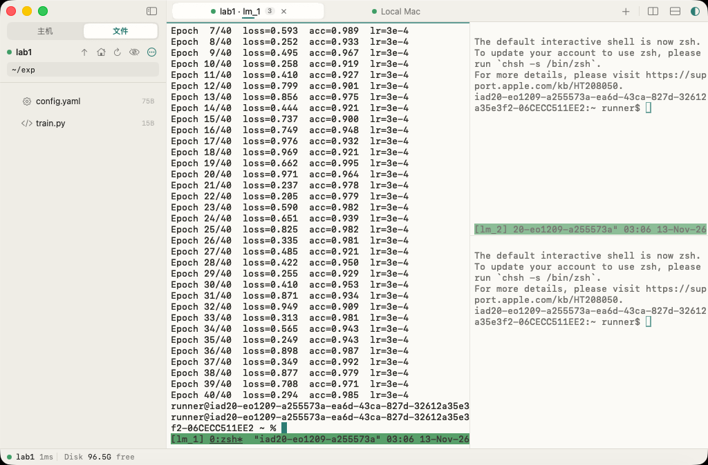
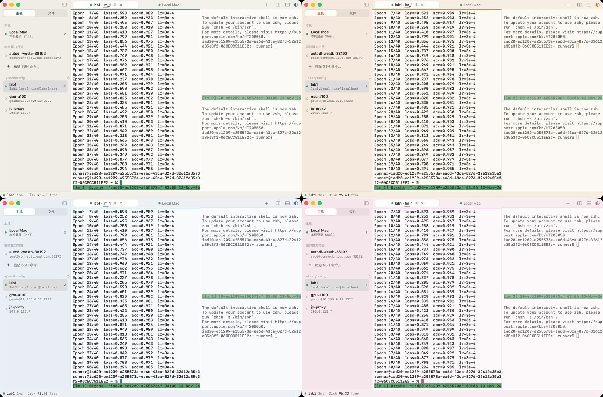
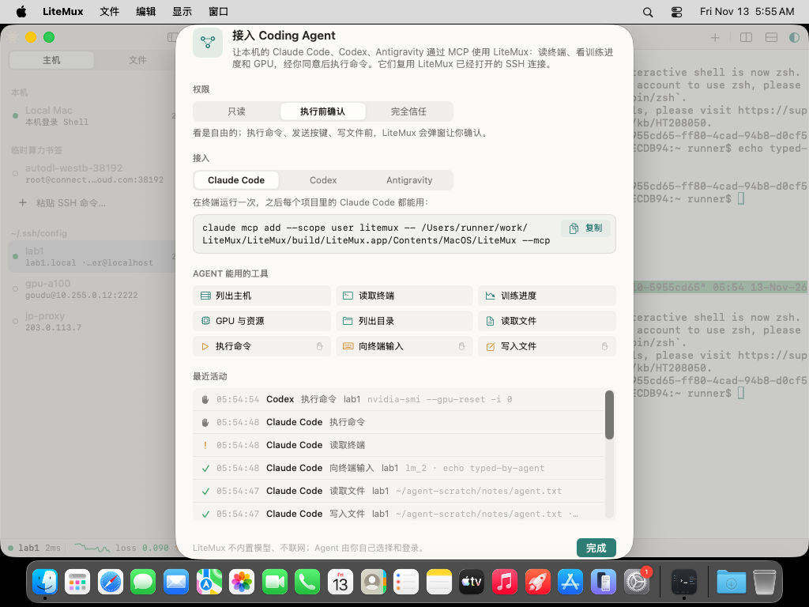
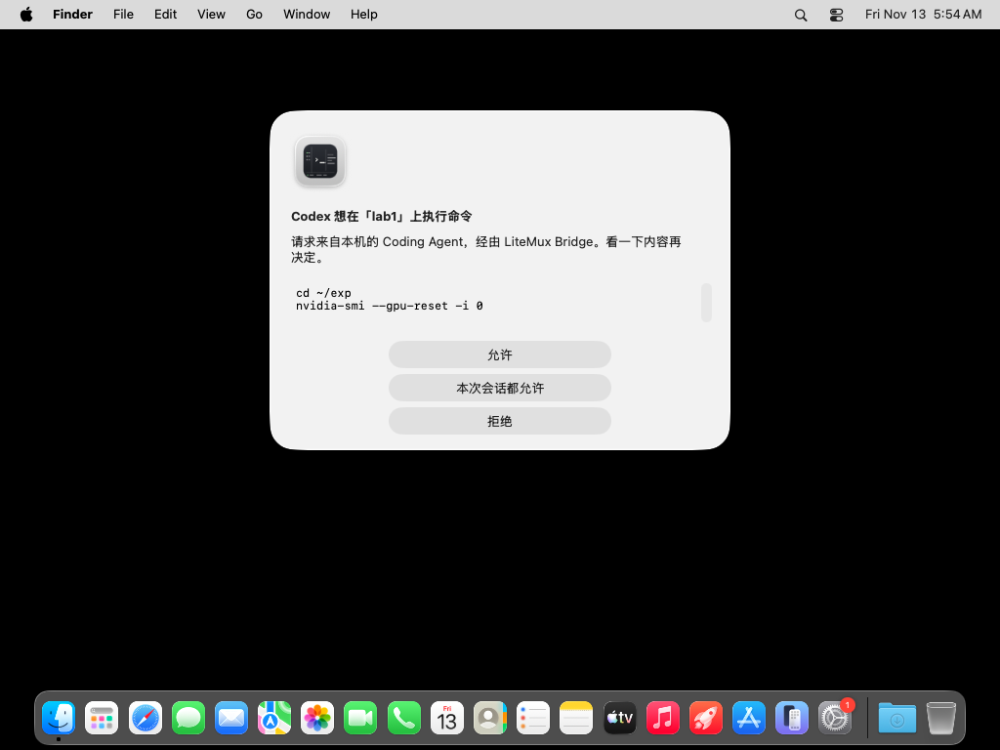

# LiteMux

macOS 原生的轻量 SSH 与 `tmux` 工作台。左侧切换服务器、浏览远程文件，右侧像 tmux 一样分屏开终端、改配置，底部一行看 CPU / 内存 / 磁盘 / GPU。

- **纯原生**：Swift + AppKit + SwiftUI，终端引擎是 [SwiftTerm](https://github.com/migueldeicaza/SwiftTerm)（Metal 渲染）。没有 Electron，没有内嵌浏览器，也没有本地 HTTP 服务。
- **复用系统 OpenSSH**：`~/.ssh/config`、`ProxyJump`、密钥代理都照常生效；同一台主机的终端、SFTP 和状态探针共用一条 `ControlMaster` 隧道。
- **远端零注入**：每个窗格挂到自己的 `lm_<槽位>` tmux 会话，断线、合盖、退出应用都不会中断任务。远端不会被装任何东西。
- **零账号、零遥测**：所有状态都在 `~/.config/litemux/state.json`，密码只放在 macOS 钥匙串里。
- **不内置 AI，只开放接口**：本机的 Claude Code、Codex、Antigravity 可以通过 MCP 接入 LiteMux，读终端、看训练进度和 GPU；执行命令前由你在 LiteMux 里点头。


| SFTP 文件树 | 深色「暗房」主题 |
| --- | --- |
|  |  |

四套配色，每套都有浅色和深色版本，可以在顶栏的外观菜单里切换：纸面 · 墨青、杏橘、雾蓝、樱粉。



截图来自 CI：在 macOS 26 上对本机 sshd 真实连接后自动截取（见 `.github/workflows/ui-smoke.yml`）。

## 构建

需要 macOS 14+ 和 Xcode 26（Swift 6.2）。

```bash
make app     # 生成 build/LiteMux.app（arm64，release，ad-hoc 签名）
make run     # 构建并打开
make test    # 跑 LiteMuxCore 的单元测试
```

也可以直接用 Xcode 打开 `Package.swift`。每次推送，GitHub Actions 都会在 macOS 上构建，并把 `LiteMux.app` 作为构建产物上传。

从 Actions 下载的包没有经过公证，第一次打开时请右键选择「打开」，或者运行 `xattr -dr com.apple.quarantine LiteMux.app`。

## 接入 Coding Agent（LiteMux Bridge）

LiteMux 的可执行文件同时是一个 MCP server：`LiteMux --mcp`。Agent 启动它、通过 stdio 对话；它复用 LiteMux 已经打开的 SSH 连接，所以要密码或验证码的机器只要在 LiteMux 里开着终端就能用。菜单「LiteMux → 接入 Coding Agent…」里可以复制下面的配置，也能看到 Agent 最近做了什么。

```bash
# Claude Code
claude mcp add --scope user litemux -- /Applications/LiteMux.app/Contents/MacOS/LiteMux --mcp
```

```toml
# Codex：~/.codex/config.toml
[mcp_servers.litemux]
command = "/Applications/LiteMux.app/Contents/MacOS/LiteMux"
args = ["--mcp"]
```

Antigravity 在 MCP Servers → Manage → View raw config 里加入同样的 `command` / `args`（`mcpServers.litemux`）。

| 接入面板 | 执行前确认 |
| --- | --- |
|  |  |

| 工具 | 作用 | 权限 |
| --- | --- | --- |
| `list_hosts` | 书签、`~/.ssh/config`、本机；是否已连接，每台机器上的 tmux 会话 | 读 |
| `read_terminal` | 读某个窗格（tmux `lm_<n>`）最近的输出 | 读 |
| `training_status` | 从窗格日志里解析训练状态、epoch 进度、各指标最新 / 最佳 / 趋势、loss 曲线和上一次运行 | 读 |
| `gpu_status` | 每张卡的利用率、显存、温度、功耗和占显存的进程，外加负载、内存、磁盘 | 读 |
| `list_directory` / `read_file` | 列目录、读文本文件（可只读日志末尾 N 行，二进制拒绝） | 读 |
| `run_command` | 跑一条短命令（`bash -lc`），返回退出码和输出 | 确认 |
| `send_to_terminal` | 往窗格里输入一行（可先 Ctrl-C），适合启动或重启训练 | 确认 |
| `write_file` | 写入或追加文本文件 | 确认 |

三种模式存在 `~/.config/litemux/bridge.json`：**只读**（不提供后三个工具）、**执行前确认**（默认，每次弹窗；回车不会误点允许）、**完全信任**。所有调用都记在 `~/.config/litemux/bridge-activity.jsonl`。

## 快捷键

| 快捷键 | 作用 |
| --- | --- |
| ⌘N | 新建 / 粘贴 SSH 连接 |
| ⌘T / ⇧⌘T | 在当前主机 / 本机新建终端标签页 |
| ⌘D / ⇧⌘D | 左右 / 上下分屏，新窗格分配新的 tmux 槽位 |
| ⌘W | 关闭当前窗格或编辑标签页，不会关闭窗口 |
| ⌘B | 收起或展开侧边栏 |
| ⌘S | 保存远程文件，原地写回并保留原权限 |
| ⌘1…9、⇧⌘[ / ] | 切换标签页 |
| ⌘= / ⌘- / ⌘0 | 调整字号 |

Ctrl 组合键（Ctrl+C、Ctrl+D、Ctrl+Z 等）会原样发给远端进程。

架构说明见 [docs/architecture.md](docs/architecture.md)，原始需求见 [docs/prd.md](docs/prd.md)。
