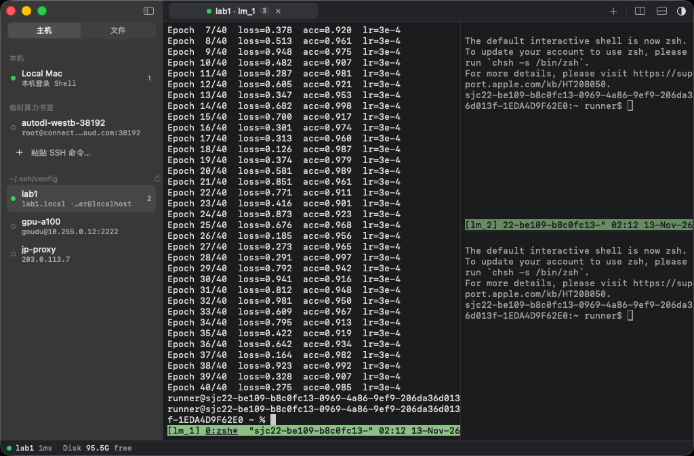
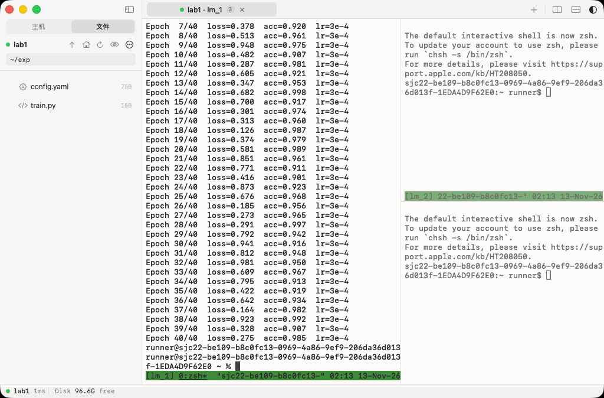

# LiteMux

macOS 原生的轻量 SSH 与 `tmux` 工作台。左侧切换服务器、浏览远程文件，右侧像 tmux 一样分屏开终端、改配置，底部一行看 CPU / 内存 / 磁盘 / GPU。

- **纯原生**：Swift + AppKit + SwiftUI，终端引擎是 [SwiftTerm](https://github.com/migueldeicaza/SwiftTerm)（Metal 渲染）。没有 Electron，没有内嵌浏览器，也没有本地 HTTP 服务。
- **复用系统 OpenSSH**：`~/.ssh/config`、`ProxyJump`、密钥代理都照常生效；同一台主机的终端、SFTP 和状态探针共用一条 `ControlMaster` 隧道。
- **远端零注入**：每个窗格挂到自己的 `lm_<槽位>` tmux 会话，断线、合盖、退出应用都不会中断任务。远端不会被装任何东西。
- **零账号、零遥测、零 AI**：所有状态都在 `~/.config/litemux/state.json`，密码只放在 macOS 钥匙串里。





截图来自 CI：在 macOS 26 上对本机 sshd 真实连接后自动截取（见 `.github/workflows/ui-smoke.yml`）。

## 构建

需要 macOS 14+ 和 Xcode 26（Swift 6.2）。

```bash
make app     # 生成 build/LiteMux.app（arm64，release，ad-hoc 签名）
make run     # 构建并打开
make test    # 跑 LiteMuxCore 的单元测试
```

也可以直接用 Xcode 打开 `Package.swift`。每次推送，GitHub Actions 都会在 macOS 上构建，并把 `LiteMux.app` 作为构建产物上传。

从 Actions 下载的包没有经过公证，第一次打开时请右键选择「打开」，或者运行 `xattr -dr com.apple.quarantine LiteMux.app`。

## 快捷键

| 快捷键 | 作用 |
| --- | --- |
| ⌘N | 新建 / 粘贴 SSH 连接 |
| ⌘T / ⇧⌘T | 在当前主机 / 本机新建终端标签页 |
| ⌘D / ⇧⌘D | 左右 / 上下分屏，新窗格分配新的 tmux 槽位 |
| ⌘W | 关闭当前窗格或编辑标签页，不会关闭窗口 |
| ⌘B | 收起或展开侧边栏 |
| ⌘S | 保存远程文件，原地写回并保留原权限 |
| ⌘1…9、⇧⌘[ / ] | 切换标签页 |
| ⌘= / ⌘- / ⌘0 | 调整字号 |

Ctrl 组合键（Ctrl+C、Ctrl+D、Ctrl+Z 等）会原样发给远端进程。

架构说明见 [docs/architecture.md](docs/architecture.md)，原始需求见 [docs/prd.md](docs/prd.md)。
