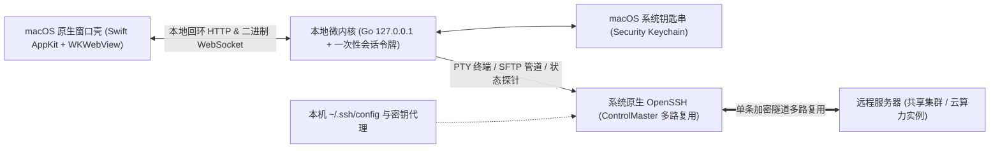

# LiteMux 产品需求文档（PRD）

- **文档版本**：`v1.0`（正式定稿）
- **产品名称**：LiteMux
- **目标平台**：macOS（Apple Silicon `arm64` 原生桌面应用 `.app`）
- **核心体积与性能目标**：安装包 `< 15 MB`，冷启动 `< 0.3 s`，空闲内存 `< 80 MB`

---

## 1. 产品背景与核心定位

### 1.1 现有工具的核心痛点
日常同时连接多台 **SSH**（Secure Shell，安全外壳协议）服务器（如实验室常驻共享服务器、按量计费的 AutoDL 云算力实例、轻量云主机）时，现有客户端普遍存在两难：
1. **纯命令行终端（系统 Terminal + `tmux`）**：足够轻快且支持断线保活，但多服务器切换、查看远端目录层级、顺手修改配置文件或收发实验结果文件全靠手敲 `scp` / `vim` 命令，缺少直观空间感。
2. **重型图形化客户端（Wave Terminal / Termius / VS Code Remote-SSH）**：
   - 基于 Electron 打包整套浏览器的客户端动辄 `250 MB+`，内存占用高，且常捆绑自家 AI 聊天侧边栏、内置网页浏览器与遥测服务；
   - 商业客户端（如 Termius）强制注册登录，免费版阉割了 **SFTP**（SSH File Transfer Protocol，SSH 文件传输协议）可视化文件传输能力；
   - VS Code `Remote-SSH` 每次连接新机器都需往远端写入数百 MB 的 `.vscode-server` 后台进程，在频繁销毁重建的云算力容器或磁盘配额受限的共享服务器上既慢又重。

### 1.2 一句话产品定位
**LiteMux** 是一款面向开发者与科研用户的 **macOS 原生轻量 SSH 与 `tmux` 工作台**——左侧像 VS Code 一样直观切换服务器与管理远程文件树，右侧像 `tmux` 一样自由分屏运行终端与编辑配置文件，底部单行实时展示服务器核心资源与显卡占用。

> [!IMPORTANT]
> **四条产品红线（Non-Goals，坚决不做）**
> 1. **零 AI 捆绑**：不内置任何 AI 对话框、代码补全侧边栏、API 密钥配置或推广入口。
> 2. **零账号与云同步**：不设注册登录，不上传任何配置或遥测数据，全部状态仅存本机。
> 3. **零远端进程注入**：不在远程服务器安装任何自定义守护进程或插件目录，保持远端环境 100% 干净。
> 4. **零 Electron 臃肿依赖**：不打包 Chromium 与 Node 运行时，直接复用 macOS 原生视图容器与系统级 OpenSSH。

---

## 2. 视觉风格与空间布局

### 2.1 视觉设计风格（语义化主题，不绑定固定颜色）
整体采用 **「克制原生的桌面工具台风格（Clean Native Workbench）」**，在规范中不硬编码写死某一种具体色值，而是通过语义化外观层实现干净耐看的视觉体验：
- **无干扰工业极简风**：以低对比度的中性层级区分「侧边导航栏」「主工作区」与「底部状态栏」，依靠留白、字重对比与 `1px` 细分割线建立界面秩序；砍掉一切装饰性渐变背景、发光描边、浮夸大圆角卡片与彩色图标底座。
- **语义化主题自适应**：界面所有表面、文本、边框、选中态与终端画布均绑定语义化主题变量（如主画布、次级侧栏、正文、弱化说明、分割线、在线/告警状态点），默认无缝跟随 macOS 系统外观自动切换深浅模式，也支持在设置中一键切换浅色纸面风或深色暗房风而不破坏组件结构。
- **字体排印规范**：
  - 侧边栏、标签栏与弹窗控件采用系统原生无衬线界面字体，确保高分屏（Retina）下的紧凑清晰度；
  - 终端画布、代码编辑器、远端路径栏与底部监控读数统一使用等宽字体，并全局开启等宽数字对齐（`tabular-nums`），避免资源数值跳动时引发排版抖动。

### 2.2 窗口三段式空间拓扑
主窗口沿用符合直觉的 **「左侧双模边栏 + 右侧多标签分屏区 + 底部单行状态栏」** 结构：

```text
+----------------------------------------------------------------------------------+
| ● ● ●   LiteMux                          [新建连接]  [左右分屏]  [上下分屏]  [外观] |
+--------------------+------------------------------+------------------------------+
| [主机]    [文件树]  | [终端: lab1 · lm_1]  [config.yaml ●]  [终端: autodl-38192]  |
|--------------------|------------------------------+------------------------------|
| ▼ 本机              | goudu@lab1:~/exp$            | # config.yaml         [保存] |
|   ● Local Mac      | python train.py --fold 0     | seed: 42                     |
|                    | Epoch 18/50  loss=0.142      | batch_size: 64               |
| ▼ 临时算力书签      |                              | lr: 3e-4                     |
|   ● autodl-38192   |------------------------------+------------------------------|
|   [+ 粘贴SSH命令]   | goudu@lab1:~/exp$                                           |
|                    | tail -f logs/train.log                                      |
| ▼ ~/.ssh/config    |                                                             |
|   ● lab1           |                                                             |
|   ○ lab2           |                                                             |
|   ○ jp-proxy       |                                                             |
+--------------------+-------------------------------------------------------------+
| ● lab1 (24ms)  |  CPU 16%  |  RAM 38.4/128G  |  Disk 412G free  |  GPU0 1.2/24G  |
+----------------------------------------------------------------------------------+
```

- **尺寸与折叠约束**：左侧边栏默认宽度 `240px`，支持鼠标拖拽调整宽度（范围 `180px`–`420px`）及快捷键 `Cmd + B` 一键折叠/展开，折叠后主工作区占满全屏。

---

## 3. 核心功能需求详述

### 3.1 左侧栏模块一：主机连接管理（Servers）

| 功能项 | 详细交互与规则定义 |
| :--- | :--- |
| **本机终端入口** | 顶部固定保留 `Local Mac` 入口，点击即可在右侧打开本机默认登录 Shell 并浏览本机文件目录，方便本地与远端同屏对照操作。 |
| **`~/.ssh/config` 自动同步** | 启动及刷新时自动解析 `~/.ssh/config`（支持递归展开 `Include` 指令）：<br>1. 自动过滤含 `*`、`?`、`!` 的通配规则块（如 `Host *`、`Host autodl-*`），仅展示可直连的具体主机；<br>2. 单行 `Host` 含多个别名或 IP 时，取首个具体名称作为主标题，其余地址或 `user@hostname:port` 作为次行弱化副标题；<br>3. 只读解析，绝不篡改用户原有的 `~/.ssh/config` 文件。 |
| **整行 SSH 命令粘贴直连** | 专为云算力平台高频租卡场景设计：新建连接弹窗顶部提供智能解析输入框，支持直接粘贴平台复制的完整命令（如 `ssh -p 38192 root@connect.westb.seetacloud.com`、`ssh -i ~/.ssh/id_ed25519 ubuntu@1.2.3.4 -p 2222` 或 `user@host:port`）：<br>1. 粘贴瞬间自动拆解填充 `Host`、`Port`、`User`、`IdentityFile` 字段；<br>2. 自动生成易读默认书签名（如识别 `*.seetacloud.com` 自动命名为 `autodl-<区域>-<端口>`）；<br>3. 支持一键保存为临时算力书签，实例释放后右键或点删除图标即可连同钥匙串密码一并清除。 |
| **三种认证方式全兼容** | 1. **公钥 / Agent 免密**：直接走系统 SSH 配置与钥匙串代理无感登录；<br>2. **保存密码自动填充**：书签中录入的密码写入 macOS 系统钥匙串，连接时自动喂给 SSH，免重复手敲；<br>3. **终端内交互登录**：未保存密码且需手敲密码或输入 **2FA**（Two-Factor Authentication，双因素认证）动态验证码的机器，直接在右侧终端内交互输入，认证通过后文件树与底部监控自动复用该连接上线。 |

### 3.2 右侧模块：多标签与类 `tmux` 分屏终端工作区

1. **真终端渲染与交互**：
   - 基于 **PTY**（Pseudo-Terminal，伪终端）与硬件加速终端画布实现完整 `xterm-256color` / `truecolor` 支持，完整兼容 `vim`、`htop`、`tmux`、`nvidia-smi`、中文宽字符排版与动态窗口尺寸同步（`SIGWINCH`）。
2. **多标签与二叉树任意分屏**：
   - 顶部标签栏支持同时打开多台不同服务器的终端标签页或远程文件编辑标签页；
   - 每个终端标签页内部支持无限层级的左右分屏与上下分屏，支持拖拽分隔条调整比例，关闭子窗格后剩余窗格自动平滑占满空位；
   - 本地自动持久化工作区布局，重启应用可恢复上次打开的标签结构。
3. **核心机制：远端 `tmux` 独立槽位自动保活**：
   - 每个主机支持独立开关 **`自动挂载远端 tmux`**（远端服务器默认开启，本机入口默认关闭）；
   - **防分屏镜像冲突设计**：同一台服务器打开多个分屏窗格时，禁止所有窗格挂载到同一个固定会话名（否则会导致左右两个窗格画面完全同步镜像）。系统为每个本地窗格分配独立的槽位编号 `<slot>`，远端连接时执行条件挂载逻辑：检测远端存在 `tmux` 命令则执行 `tmux new-session -A -s lm_<slot>`，不存在则静默回退至用户默认登录 Shell；
   - **不污染远端配置原则**：严禁使用 `tmux set -g` 修改用户远端全局配置，完全尊重用户远端已有的 `~/.tmux.conf`。
   - **断线保活效果**：用户直接退出 LiteMux、切换网络或合上 Mac 休眠，远端训练进程在 `lm_<slot>` 会话中持续运行；重新打开应用连接后直接回到断开前的终端上下文。

### 3.3 左侧栏模块二：远程文件树与轻量编辑（Files & Editor）

1. **目录树浏览**：
   - 自动跟随当前激活终端或所选主机切换目标文件系统，展示当前路径面包屑（支持直接输入路径回车跳转、返回上级目录、一键回到 `~` 主目录、手动刷新、切换显示/隐藏以 `.` 开头的隐藏文件）；
   - 排序规则固定为**文件夹置顶、文件居下**，同类按名称不区分大小写字典序排列；对符号链接自动探测目标是否为目录。
2. **文件管理与传输**：
   - 支持在当前目录新建空文件、新建文件夹、重命名、递归删除（删除前必须弹出明确确认提示，防误删数据）；
   - 支持在任意文件夹节点上执行 **「在此目录打开新终端」**，新终端直接 `cd` 进入该路径；
   - **上传**：支持将 Finder 中的一个或多个文件直接拖拽进文件树目录（或点击上传按钮唤起原生文件选择框），采用流式传输写往远端，内存占用与文件体积解耦；
   - **下载**：对远端文件执行下载时，流式保存至本机 `~/Downloads`（同名文件自动追加序号防覆盖），下载完成后支持一键在 Finder 中高亮定位该文件。
3. **远程小文件即点即改**：
   - 在文件树点击常见文本与代码文件（`.py`、`.yaml`、`.yml`、`.json`、`.toml`、`.sh`、`.md`、`.txt`、`.log`、`.conf` 等），直接在右侧主工作区打开编辑标签页；
   - 编辑器显示行号与基础语法区分，内容修改但未保存时标签标题显示未保存圆点标记（`●`），关闭未保存标签时提示确认，`Cmd + S` 原地写回服务器并保持原文件权限；
   - **大文件与二进制保护门限**：打开前先检查文件元信息与头部字节——体积超过 **`5 MB`** 或检测到含空字节（`\0`）的二进制文件（如 `.pt` 模型权重、压缩包、图片）时，拒绝载入文本编辑器并给出清晰提示引导用户下载查看，杜绝界面卡死。

### 3.4 底部模块：24px 极简服务器状态栏

底部固定 `24px` 单行状态栏，仅对**当前前台激活主机**每 `5 秒` 静默采样一次（切到后台的主机立即停止轮询，零冗余开销）：
- **连接与基础负载**：显示在线状态点、主机名与 **RTT**（Round-Trip Time，往返时延，单位 `ms`）、**CPU**（Central Processing Unit，中央处理器）总利用率百分比、**RAM**（Random Access Memory，随机存取存储器）`已用 / 总量`、主目录所在磁盘可用空间。
- **GPU 自动探针**：自动探测远端是否存在 `nvidia-smi`：
  - 若存在 **GPU**（Graphics Processing Unit，图形处理器），直接并排展示每张卡的**显存占用与核心利用率**（格式如 `GPU0 0.4/24G 0% · GPU1 22.8/24G 97%`，超过单行宽度时支持横向微滚或悬停查看全卡详情），方便在多卡共享服务器上秒判空闲卡号；
  - 若远端无 NVIDIA 显卡，自动隐藏 GPU 字段，不显示报错占位符。

---

## 4. 快捷键与 macOS 原生交互规范

必须严格区分 macOS 窗口级 `Cmd` 组合键与终端内部 `Ctrl` 控制信号，禁止窗口快捷键吞掉终端信号或误关整个应用窗口：

| 快捷键 | 触发行为 | 备注说明 |
| :--- | :--- | :--- |
| `Cmd + N` | 打开「新建 / 粘贴 SSH 连接」弹窗 | 自动聚焦到整行命令粘贴输入框 |
| `Cmd + T` | 基于当前激活主机新建终端标签页 | 分配新的独立 `tmux` 槽位 |
| `Cmd + D` | 将当前终端窗格**左右分屏** | 新窗格继承当前主机连接，分配新槽位 |
| `Cmd + Shift + D` | 将当前终端窗格**上下分屏** | 新窗格继承当前主机连接，分配新槽位 |
| `Cmd + W` | 关闭当前聚焦的子分屏或编辑标签页 | **严禁直接关闭整个 macOS 主窗口** |
| `Cmd + B` | 折叠 / 展开左侧边栏 | 释放全宽空间给多列分屏终端 |
| `Cmd + S` | 保存当前激活的远程文本文件 | 仅在编辑器聚焦或激活时生效 |
| `Cmd + C` / `Cmd + V` | 复制终端选区文本 / 粘贴剪贴板至终端 | 走 macOS 原生剪贴板响应链 |
| `Ctrl + C` / `Ctrl + D` / `Ctrl + Z` | 向远端 PTY 透传 `SIGINT` / `EOF` / `SIGTSTP` | 原样透传给远端进程，本地不拦截 |
| `Cmd + Q` | 退出 LiteMux 应用 | 自动回收本地子进程与 SSH 复用套接字（不影响远端 `tmux` 内任务） |

---

## 5. 技术架构与底层工程约束

### 5.1 系统架构拓扑



### 5.2 五条核心工程实现规范
1. **100% 复用系统 `/usr/bin/ssh` 与单连接多路复用**：
   - 不采用对 `ProxyJump`、`Match` 块及系统代理兼容性残缺的第三方纯软件 SSH 协议库，直接驱动 macOS 原生 OpenSSH 并启用 `ControlMaster=auto` + `ControlPersist=10m`；
   - **套接字路径长度约束**：macOS UNIX Domain Socket 路径上限仅 `104` 字节，控制套接字必须统一存放在短路径 `~/.ssh/lm/%C`（目录权限 `0700`），杜绝长域名连接报路径超长错误；
   - 同一台服务器首次认证建连后，后续新开分屏、SFTP 目录读写与状态栏采样全部复用该加密隧道，新开分屏耗时 `< 50 ms` 且无需二次认证。
2. **零明文落盘的密码桥接机制**：
   - 本地状态文件（`~/.config/litemux/state.json`）仅存主机元数据与界面偏好，**严禁向磁盘任何配置文件写入明文或可逆编码密码**；
   - 密码统一通过标准输入管道调用系统钥匙串服务存取（避免密码出现在子进程命令行参数中被 `ps` 捕获）；
   - 自动填充密码时，由本地内核自身响应 OpenSSH 原生 `SSH_ASKPASS` + `SSH_ASKPASS_REQUIRE=force` 机制，并设置 `NumberOfPasswordPrompts=1`，密码错误时单次即停，防止连续重试触发远端 `fail2ban` 封禁 IP。
3. **基于标准二进制流的 SFTP 传输**：
   - 远程文件管理通过 `/usr/bin/ssh <host> -s sftp` 标准输入输出管道对接二进制 SFTP 协议客户端，严禁采用执行远端 `ls -la` 再正则解析文本输出的脆弱方案，彻底消除远端系统语言环境（Locale）、特殊字符与空格文件名引发的解析错误。
4. **终端二进制帧传输防断字乱码**：
   - 终端 PTY 与前端画布之间的 WebSocket 通道必须使用**二进制帧（Binary Frame）**直传原始字节流，交由前端流式 UTF-8 解码器重组，防止多字节中文字符或 ANSI 控制序列在固定缓冲区边界被截断产生乱码。
5. **本地回环隔离与零孤儿进程**：
   - 本地内核仅绑定 `127.0.0.1:0`（系统分配随机空闲端口），每次启动生成 `256-bit` 随机令牌校验所有 HTTP 与 WebSocket 请求，阻断本机浏览器网页跨站请求与 **CSRF**（Cross-Site Request Forgery，跨站请求伪造）；
   - 原生窗口退出时主动终止内核子进程并清理 `~/.ssh/lm/` 下的控制套接字；内核子进程同时监控父进程生命周期，若父窗口异常强退则自动退出，保证系统零残留后台进程。

---

## 6. 异常与边界场景处理矩阵

| 异常场景 | 预期系统行为 |
| :--- | :--- |
| **尚未完成终端密码认证时点击文件树** | 后台 SFTP 与探针请求一律携带 `BatchMode=yes` 与 `6s` 超时，立即返回非阻塞提示「等待终端完成认证」，绝不在后台挂死进程；待右侧终端完成登录建起复用隧道后一键刷新即通。 |
| **保存的书签密码错误或实例已销毁** | 因限制 `NumberOfPasswordPrompts=1`，单次握手失败后立即在终端与状态栏给出明确认证失败/连接拒绝提示，引导更新密码或删除过期书签。 |
| **网络闪断或 Mac 合盖唤醒** | 断开的终端窗格显示轻量重连横幅（支持回车或点击一键原地重连回原 `lm_<slot>` 会话）；失效的 SFTP 句柄自动驱逐重建。 |
| **远端服务器未安装 `tmux` 或 `nvidia-smi`** | 无 `tmux` 时自动无缝降级启动默认登录 Shell，不打印命令未找到报错；无 `nvidia-smi` 时状态栏自动隐藏 GPU 区段。 |
| **误点超大日志文件（`> 5 MB`）或二进制权重** | 在 `Stat` 阶段直接拦截，弹窗提示实际文件体积并提供「直接下载到 Downloads」快捷按钮，主界面零卡顿。 |

---

## 7. 交付与验收标准（Acceptance Criteria）

1. **轻量与纯净度验收**：
   - 编译产出的 `LiteMux.app` 整包体积 `< 15 MB`，通过本地签名运行无拦截；
   - 应用内无任何 AI 入口、无外网第三方遥测请求；连接并操作远程服务器后，检查远端主目录无任何新增隐藏守护目录（仅标准 `.ssh` 或用户主动开启的 `tmux` 会话）。
2. **核心链路端到端验收**：
   - 打开应用即自动列出本机 `~/.ssh/config` 中的全部具体主机别名，无需手动导入；
   - 粘贴整行 `ssh -p <端口> <用户>@<域名>` 命令可正确拆解出主机、端口与用户，保存密码后重连无需二次输入；
   - 在同一台远程主机下按 `Cmd + D` 分出左右两个窗格，验证两窗格各自拥有独立光标与工作目录（不发生画面镜像），关闭应用重开后两窗格的原运行任务均未中断；
   - 在左侧文件树点击远端配置文件修改并按 `Cmd + S`，远端文件内容实时更新且权限不变；拖拽本地文件至文件树可流式上传成功，点击下载可保存至 `~/Downloads`；
   - 连接含 NVIDIA 显卡的服务器时，底部状态栏 5 秒内准确显示延迟、CPU、内存与各张 GPU 的显存读数。
